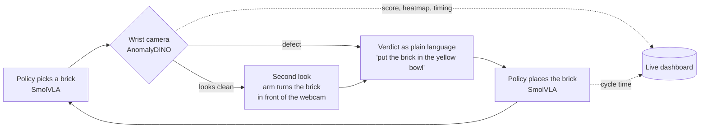

# See it. Detect it. Sort it.

**A brick inspection cell on one Intel Core Ultra laptop** — our entry for the
[Intel Physical AI Challenge](CHALLENGE.md) at Junction 2026.

An SO-101 arm picks a Duplo brick out of a box, an anomaly model checks it for defects while it is still
in the gripper, and a vision-language-action policy drops it into the right bowl. Everything runs locally
on the station laptop, under the stock light of the station, with no light box and no cloud at runtime.

Team: Julian, Tobby, Samuel.

## How it works



1. **Pick.** The fine-tuned SmolVLA policy picks a brick. As soon as the brick is lifted, the sorter
   stops the policy and the arm holds still.
2. **Inspect in the gripper.** The wrist camera image goes through an Anomalib model (AnomalyDINO)
   trained on good bricks only. A brick with a marker stroke scores above the threshold.
3. **Second look.** If the wrist camera sees nothing, the arm carries the brick in front of the
   inspection webcam and turns the wrist through eight angles, so every side is checked.
4. **Decide in plain language.** The verdict is handed to the policy as a task text:
   `put the brick in the yellow bowl` (defective) or `put the brick in the blue bowl` (good).
5. **Place and repeat.** The policy takes over again, places the brick, and the next cycle starts.

The **dashboard** shows every brick live: verdict, anomaly score, cycle time, throughput, inference
latency, and the load on CPU, iGPU and NPU with power and temperature.

**Learning from its own wins.** While the policy runs, `robot/scripts/record_successes_gui.py` records
every cycle. A person judges it with one click, and each successful cycle is saved as a new training
episode. The next model is fine-tuned on the robot's own successes, not only on our demonstrations.

## Numbers

| What | Value |
|---|---|
| Demonstrations recorded | 755 episodes, 92 minutes of robot motion (two datasets: 400 + 355 episodes) |
| Policy | SmolVLA, fine-tuned on Modal (H100), runs on the laptop's Arc iGPU through PyTorch XPU |
| Policy commands | two task texts: yellow bowl or blue bowl |
| Anomaly model | Anomalib AnomalyDINO (DINOv2 ViT-B, 448 px), trained on the laptop from good bricks only |
| Detection on our test set | 13 wrist-camera images at threshold 0.5: all 8 marked bricks found, no false alarm on the 5 clean ones |
| Anomaly check | about 0.16 s per image on the Arc iGPU |

The test set is small and comes from one lighting setup, so read the detection result as "works on our
station", not as a general accuracy figure.

## What is in this repo

| Path | What it is |
|---|---|
| [`sorter/`](sorter/README.md) | The inspection loop. `policy_sort.py` runs the full cycle above; `anomaly_watch.py` only watches a run started in Studio and scores each brick |
| [`anomaly/`](anomaly/README.md) | Training and evaluation of the Anomalib models (PaDiM, PatchCore, AnomalyDINO, Dinomaly) |
| [`frontend/`](frontend/README.md) | Live dashboard: a small hub server plus a plain HTML/JS page, no dependencies |
| [`robot/`](robot/README.md) | Station state for Physical AI Studio (calibration, cameras, environment) and the tools to record successful cycles |
| `inspection/` | Tools to capture training images from the wrist camera, directly or from the running Studio |
| `tools/` | `policy_debug_view.py`: live view of what the policy sees and plans, and which camera it relies on |
| [`station/`](station/README.md) | Scripts for the station laptop: start Studio, GPU drivers, GPU load, camera re-plug fix |
| `poses/` | The taught inspection pose in front of the webcam |
| [`docs/CONTRACT.md`](docs/CONTRACT.md) | Interface between the sorting loop and the dashboard |

Physical AI Studio itself is not in this repo. It is the upstream project
[open-edge-platform/physical-ai-studio](https://github.com/open-edge-platform/physical-ai-studio),
cloned next to this repo. Images, datasets and model checkpoints are not committed either.

## Try it without a robot

The dashboard needs only Python 3 (standard library) and a browser:

```bash
python frontend/hub.py          # dashboard at http://127.0.0.1:8090
python frontend/simulate.py     # second terminal: demo cycles, marked "Demo data"
```

Tests (standard library only):

```bash
python -m unittest discover -s frontend/tests
python -m unittest discover -s robot/tests
```

## Run it on the station

Hardware: SO-101 follower and leader arm, top-view RealSense, inspection webcam, wrist camera, an
Intel Core Ultra laptop with Ubuntu, a yellow and a blue bowl, a box of Duplo bricks.

1. **Studio.** Clone Physical AI Studio next to this repo and import our station state:
   see [`robot/README.md`](robot/README.md). Start it with `station/start-studio.sh`.
2. **Anomaly model.** Photograph good bricks with `inspection/capture_wrist.py`, then train:
   see [`anomaly/README.md`](anomaly/README.md). The sorter expects the checkpoint at
   `~/bricks-data/model_anomalydino.ckpt` (`sorter/config.json` → `anomaly.wrist_model`).
3. **Policy.** Record demonstrations in Studio, fine-tune SmolVLA, and load the model into Studio.
4. **Dashboard.** `bash frontend/start_laptop.sh` starts the hub and the power / temperature / load readings.
5. **Sort.** Close the session in the Studio web UI, then:

   ```bash
   station/studio-python sorter/policy_sort.py
   ```

   It runs without a window. `ENTER` pauses and continues, `q` + `ENTER` stops, `Ctrl+C` stops
   (twice = emergency hold). Details and settings: [`sorter/README.md`](sorter/README.md).

`station/studio-python` runs a script with the Python environment of Studio's backend. Studio is
expected at `../physical-ai-studio`; set `PHYSICAL_AI_STUDIO` to use another checkout.

## What is real and what is not yet

- The loop, both camera checks, the hand-over to the policy and the dashboard run on the station.
- The **second look** at the webcam currently uses a classical stroke detector (`sorter/vision.py`).
  A second anomaly model for that camera can be plugged in (`anomaly.webcam_model`) but is not trained yet.
- Policy and anomaly model run on the **Arc iGPU with PyTorch**. `frontend/benchmark_openvino.py`
  compares an exported OpenVINO model on CPU, iGPU and NPU and fills the dashboard's device table;
  moving the live loop to OpenVINO and the NPU is the next step.
- The policy finds the bowls only where they stood during the demonstrations.
- Operator messages of the sorter and the on-screen labels of some station tools are in German.

## Working in this repo

Rules for people and coding agents are in [AGENTS.md](AGENTS.md), the task board in [TASKS.md](TASKS.md).
